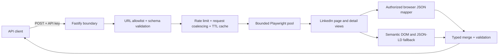

# LinkedIn Profile API

A production-oriented TypeScript service that accepts a LinkedIn `/in/` profile URL and returns the profile data visible to a configured browser session as structured JSON.

> This is an independent engineering project, not an official LinkedIn API. The current [LinkedIn User Agreement](https://www.linkedin.com/legal/user-agreement) restricts scraping, copying profile data, automated access, cookie use, and redistribution. Do not enable authenticated mode or operate this as a public scraping service without written LinkedIn authorization, an approved API agreement, and a documented lawful basis for processing. It deliberately contains no CAPTCHA bypass, fingerprint spoofing, proxy rotation, or account automation.

## What it returns

- Name, headline, location, about text, profile image, and background image
- Experience, education, skills, certifications, and languages
- Extraction mode, cache status, a completeness score, warnings, timestamp, and request ID
- Stable error codes for invalid input, missing profiles, expired sessions, upstream blocks, overload, and timeouts

## Tech stack

| Layer | Choice | Why it is here |
| --- | --- | --- |
| Runtime | Node.js 22/24 + strict TypeScript | Current LTS runtime, native `fetch`, strong contracts, and predictable builds |
| HTTP API | Fastify 5 | Low overhead, JSON Schema validation, lifecycle hooks, and structured logging |
| Browser extraction | Playwright 1.62 + Chromium | Executes the same rendered profile flow a normal browser sees |
| Data validation | Zod + Fastify JSON Schema | Validates extracted domain objects and the public HTTP contract |
| Resilience | Bounded semaphore, retry budget, deadline, LRU cache, request coalescing | Prevents browser overload and duplicate work while bounding memory and latency |
| Security | API-key digests, Helmet, rate limiting, strict URL and egress allowlists | Protects the expensive endpoint and reduces SSRF and secret-exposure risk |
| Observability | Pino + Prometheus `prom-client` | Structured, redacted logs and low-cardinality service metrics |
| Quality | Vitest, V8 coverage, ESLint, TypeScript, Chromium fixture test | Deterministic unit/API tests plus a real-browser extraction boundary test |
| Delivery | Multi-stage Docker, GitHub Actions, CodeQL, Dependabot, Render Blueprint | Reproducible image, automated gates, HTTPS deployment, and update automation |

## Architecture



The service uses the normal browser page flow. It captures profile JSON already delivered to that same authorized page session, then combines it with semantic DOM and JSON-LD parsing. The payload mapper is tolerant of wrapper changes; the DOM fallback is tolerant of CSS-class churn because it groups sections by accessible headings. Every result is validated against the public response model before it leaves the service.

### End-to-end request flow

1. Fastify assigns or validates a request ID, applies security headers, authenticates `X-API-Key`, rate-limits by a SHA-256 key fingerprint, and rejects bodies larger than 16 KiB.
2. The input URL is parsed and canonicalized to `https://www.linkedin.com/in/<slug>/`. Credentials, custom ports, non-HTTPS schemes, unexpected hosts, and non-profile paths are rejected before a browser is touched.
3. The service returns a fresh cached result when possible. Identical concurrent misses are coalesced into one scrape job.
4. A bounded semaphore admits the job or returns a stable capacity error. Queue time, browser startup, navigation, retries, and parsing all share one overall deadline.
5. Playwright creates an isolated browser context. It can add an approved `li_at` cookie only when the explicit authenticated-mode safety gate is enabled. Browser requests are restricted to LinkedIn and LinkedIn CDN HTTPS origins; fonts and video are dropped.
6. The browser loads the base profile and each available detail view. A bounded collector reads only successful JSON responses from expected Voyager identity/GraphQL paths, while the DOM extractor reads semantic headings, cards, JSON-LD, and image sources.
7. The mapper scopes captured data to the requested member, merges JSON and DOM results, de-duplicates records, validates the final profile with Zod, and computes completeness warnings.
8. The API returns structured JSON with cache status, extraction mode, completeness, warnings, timestamp, and request ID. Known failures are normalized to stable status/code pairs; contexts always close in `finally` blocks.

### Repository layout

```text
src/app.ts                         Fastify composition, routes, middleware, and errors
src/config.ts                      Typed environment parsing and production invariants
src/extractor/linkedin-scraper.ts  Browser lifecycle, navigation, egress, capture, and deadlines
src/extractor/dom.ts               Semantic DOM and JSON-LD snapshot extraction
src/extractor/voyager.ts           Member-scoped private-response traversal
src/extractor/mapper.ts            Merge, normalization, de-duplication, and completeness
src/service/profile-service.ts     Request coalescing and bounded TTL/LRU caching
src/domain/                        Public profile and stable error models
tests/                             Unit, API, policy, mapper, and real-browser fixture tests
.github/                           CI, CodeQL, and dependency-update automation
Dockerfile / render.yaml           Reproducible runtime image and HTTPS deployment blueprint
```

## Quick start

Prerequisites: Node.js 22 or 24 (Node 24 LTS recommended), pnpm 11.19, and a Playwright-compatible Chromium installation. Docker is the simplest supported route because the image already contains the matching browser.

```bash
cp .env.example .env
export LINKEDIN_API_KEY="$(openssl rand -base64 32)"
printf 'Set API_KEYS in .env to: %s\n' "$LINKEDIN_API_KEY"
# Copy the printed value into API_KEYS in .env before starting.
docker compose up --build
```

- OpenAPI UI: `http://localhost:3000/documentation`
- Liveness: `GET http://localhost:3000/health/live`
- Readiness: `GET http://localhost:3000/health/ready` (validates that Chromium can launch and create an isolated context)

For local development without Docker:

```bash
corepack enable
pnpm install
pnpm exec playwright install chromium
cp .env.example .env
pnpm dev
```

The `pnpm dev` script and Docker Compose load `.env`; the production process otherwise reads environment variables supplied by its platform or secrets manager. The checked-in placeholder API key is intentionally rejected in production.

### LinkedIn session setup

Public mode works without `LINKEDIN_LI_AT`, but LinkedIn often limits sections or presents an authentication wall. Authenticated mode is disabled by default. Only after obtaining written authorization, sign in normally with an approved account, store its `li_at` cookie only as the deployment secret `LINKEDIN_LI_AT`, and set `AUTHENTICATED_MODE_ENABLED=true`.

The service never accepts LinkedIn credentials through the API, persists a session cookie, or writes captured upstream payloads to logs. Session cookies expire and may be revoked by LinkedIn; replace the deployment secret when `LINKEDIN_SESSION_EXPIRED` is returned. Possession of a service-account cookie does not itself make automated access policy-compliant.

## API

### `POST /v1/profiles`

Header: `X-API-Key: <one of API_KEYS>`

```json
{
  "profileUrl": "https://www.linkedin.com/in/example-person/",
  "refresh": false
}
```

`refresh` bypasses a completed cache entry. Simultaneous requests for the same URL are still coalesced to one browser job.

```bash
curl --request POST 'http://localhost:3000/v1/profiles' \
  --header 'Content-Type: application/json' \
  --header "X-API-Key: ${LINKEDIN_API_KEY}" \
  --data '{"profileUrl":"https://www.linkedin.com/in/example-person/"}'
```

Example response (unavailable optional scalar fields are omitted; unavailable collections are empty):

```json
{
  "data": {
    "profileUrl": "https://www.linkedin.com/in/example-person/",
    "name": "Example Person",
    "headline": "Staff Software Engineer",
    "location": "Bengaluru, Karnataka, India",
    "about": "I build reliable systems.",
    "profileImageUrl": "https://media.licdn.com/example.jpg",
    "experience": [
      {
        "title": "Staff Software Engineer",
        "company": "Example Corp",
        "employmentType": "Full-time",
        "location": "Bengaluru, India",
        "dateRange": {
          "startDate": "2022-01",
          "endDate": "Present",
          "duration": "4 yrs 8 mos"
        },
        "description": "Led platform reliability work.",
        "skills": ["Distributed Systems", "TypeScript"]
      }
    ],
    "education": [],
    "skills": ["Distributed Systems", "TypeScript"],
    "certifications": [],
    "languages": [{ "name": "English", "proficiency": "Professional working proficiency" }]
  },
  "meta": {
    "requestId": "7d47e2b3-6d53-4c67-8af2-24f59dcff718",
    "fetchedAt": "2026-08-31T05:30:00.000Z",
    "cache": "miss",
    "extractionMode": "authenticated",
    "completeness": 80,
    "warnings": [
      "education was not available to this LinkedIn session",
      "certifications was not available to this LinkedIn session"
    ]
  }
}
```

Error response:

```json
{
  "error": {
    "code": "LINKEDIN_SESSION_EXPIRED",
    "message": "The configured LinkedIn session is no longer accepted",
    "retryable": false,
    "requestId": "7d47e2b3-6d53-4c67-8af2-24f59dcff718"
  }
}
```

| Code | HTTP | Meaning |
| --- | ---: | --- |
| `INVALID_REQUEST` / `INVALID_PROFILE_URL` | 400 | Malformed input or a URL outside `https://*.linkedin.com/in/...`; unknown routes return a 404 `INVALID_REQUEST` |
| `UNAUTHORIZED` | 401 | Missing or invalid API key |
| `PROFILE_NOT_FOUND` | 404 | Profile was removed, renamed, or unavailable |
| `RATE_LIMITED` | 429 | Per-instance client rate limit reached |
| `UPSTREAM_ERROR` | 502 / 503 | LinkedIn extraction failed, or the Chromium runtime could not start |
| `LINKEDIN_AUTH_REQUIRED` / `LINKEDIN_SESSION_EXPIRED` / `LINKEDIN_BLOCKED` | 503 | Session configuration or temporary upstream restriction |
| `SCRAPE_CAPACITY_EXCEEDED` | 503 | Browser queue wait limit reached |
| `SCRAPE_TIMEOUT` | 504 | Overall extraction deadline reached |
| `INTERNAL_ERROR` | 500 | Unexpected server failure with details withheld from the client |

Retryable errors include `Retry-After: 5`. Client retries should use exponential backoff with jitter.

## Configuration

| Variable | Default | Notes |
| --- | --- | --- |
| `API_KEYS` | empty | Comma-separated SHA-256-compared keys; required in production |
| `AUTHENTICATED_MODE_ENABLED` | `false` | Explicit safety gate; enable only with written authorization |
| `LINKEDIN_LI_AT` | empty | Optional secret session cookie; never commit it |
| `PORT` / `HOST` | `3000` / `0.0.0.0` | HTTP bind address |
| `TRUST_PROXY_HOPS` | `0` | Trusted proxy-hop count; Render uses `1` so client-supplied forwarding headers cannot choose the rate-limit identity |
| `SCRAPE_TIMEOUT_MS` | `45000` | Whole-job deadline, 5–120 seconds |
| `NAVIGATION_TIMEOUT_MS` | `20000` | Per-navigation deadline |
| `SCRAPE_CONCURRENCY` | `2` | Browser contexts per process, capped at 10 |
| `SCRAPE_QUEUE_MAX` | `20` | Maximum queued browser jobs per process |
| `CACHE_TTL_SECONDS` | `3600` | In-memory success cache; `0` disables effective caching |
| `CACHE_MAX_ENTRIES` | `500` | Bounded LRU size |
| `CACHE_MAX_VALUE_BYTES` | `524288` | Oversized profile results are returned but not retained in the cache |
| `RATE_LIMIT_MAX` / `RATE_LIMIT_WINDOW` | `30` / `1 minute` | Per-instance rate limit |
| `MAX_RETRIES` | `1` | Retries only explicitly retryable extraction failures |
| `BROWSER_EXECUTABLE_PATH` | empty | Optional custom Chromium path |
| `LOG_LEVEL` | `info` | Pino level; sensitive headers are redacted |

## Verification

```bash
pnpm check          # strict lint + TypeScript + unit/API tests + production build
pnpm test:coverage  # coverage thresholds
docker build -t linkedin-profile-api .
```

The test suite does not call LinkedIn. It uses representative captured shapes and DOM card text so CI is deterministic, does not consume an account, and cannot expose profile data. The container build additionally launches its pinned Chromium against local fixture HTML to verify the real DOM extraction boundary. Live checks should be an opt-in deployment smoke test against a profile you control.

## Deploy over HTTPS

`render.yaml` is a ready-to-use public-mode Render Blueprint. Push this directory to a GitHub repository, create a Render Blueprint from it, and deploy. Render terminates TLS and injects a generated `API_KEYS` value. The Blueprint selects a 1 CPU / 2 GB instance because browser processes are a poor fit for sleeping, memory-constrained free tiers. It deliberately does not request or provision a LinkedIn cookie. Leave `AUTHENTICATED_MODE_ENABLED=false` unless the authorization conditions above are satisfied; an authorized operator can add `LINKEDIN_LI_AT` later through Render's secret settings.

Deployment steps:

1. Push this directory as the root of the GitHub repository and wait for CI and CodeQL to pass.
2. In Render, choose **New → Blueprint**, connect the repository, and apply `render.yaml`.
3. Review the selected 1 CPU / 2 GB paid plan and region before confirming; Chromium is not a good fit for Render's smallest tier.
4. Render builds the pinned multi-stage image, waits for passing GitHub checks on later commits, terminates HTTPS, generates `API_KEYS`, and probes `/health/ready`.
5. Leave authenticated mode off for the public deployment. Add secrets only through Render's environment settings, never through Git or build arguments.

After deployment:

1. Confirm `/health/ready` returns `200`.
2. Read the generated `API_KEYS` secret and make one authorized request.
3. Confirm a second request reports `"cache":"hit"`.
4. Verify `/metrics` requires the same API key and contains no profile URL labels.
5. Enable branch protection and require the CI and CodeQL checks.

## Production considerations and limitations

- LinkedIn's private response shapes and page structure are not a supported public contract. The dual extractor and fixtures reduce change risk, but selectors and mappings still require maintenance.
- Results are limited to fields visible to the configured account, locale, member privacy settings, region, A/B test, and page state. Empty arrays mean “not available,” not necessarily “does not exist.”
- The cache and rate limiter are intentionally in-process for a single-instance challenge deployment. Requests are keyed by a non-reversible API-key fingerprint (or trusted client IP when no key is present). Multi-replica production should move both to Redis and use a durable queue with per-account quotas.
- Profile and image URLs can expire or change. This API returns upstream URLs; it does not proxy or permanently store images.
- Synchronous browser jobs have higher latency than a normal JSON API. At larger scale, expose an asynchronous job resource (`202`, job ID, status endpoint/webhook).
- Account checkpoints, CAPTCHA, authentication walls, and HTTP `999` are surfaced as errors. The service does not attempt to bypass them.
- The service minimizes data retention, but callers and operators remain responsible for lawful basis, consent where required, deletion, access control, and retention policy.
- Returned third-party URLs are untrusted output. Consumers must not dereference them server-side without their own URL validation and egress controls.

## Security decisions

- Strict HTTPS LinkedIn host and `/in/` path allowlist before navigation; credentials, custom ports, and non-profile URLs are rejected. Browser egress is limited to LinkedIn and LinkedIn CDN HTTPS origins, and final navigation origins are revalidated.
- API keys are compared as fixed-length SHA-256 digests using timing-safe comparison.
- Secrets and request bodies are excluded from logs; cookies and security headers are redacted.
- Browser work has a hard deadline, bounded concurrency and queueing, aggregate response-capture limits, bounded cache, and retry caps.
- The runtime image uses Playwright's non-root user. Local Docker Compose additionally enables a read-only filesystem, drops Linux capabilities, and provides only a bounded writable temporary filesystem. Apply equivalent controls through the chosen cloud platform where supported; Render does not inherit Compose settings.
- CI enforces lint, strict types, coverage thresholds, a production build, a Chromium-backed fixture test, an image build, a running-container smoke test, dependency updates, and CodeQL analysis.

See [SECURITY.md](SECURITY.md) for private vulnerability reporting and incident steps.
